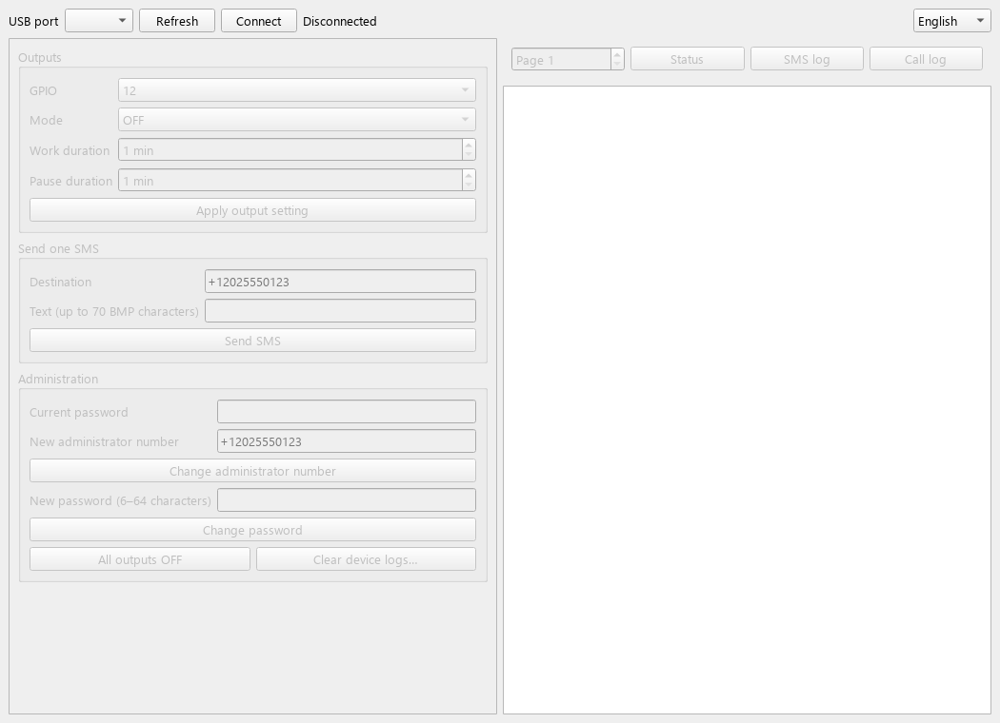

# TCall Pager

ESP32/SIM800L output controller with SMS control and a Windows desktop client
for **LilyGO T-Call v1.3**.

[Releases](https://github.com/earendel-dev/TCall_Pager/releases) ·
[USB protocol](docs/PROTOCOL.md) · [Validation](docs/VALIDATION.md) ·
[Changelog](CHANGELOG.md) · [Baseline audit](docs/AUDIT.md)

> **1.1.0-rc.2 is a release candidate.** Its desktop client requires TCALL/1
> firmware (rc.1 or rc.2). Keep using v1.0.0 with the original firmware until
> the device is upgraded. Installing the desktop client does not flash the
> board. Existing releases are preserved.



## What it does

- Control GPIO 12, 14, 15, 2, 21, 22 and 25: OFF, constant ON, timer or work/pause cycle.
- Accept output commands from one administrator phone number.
- Record SMS/call events in LittleFS, retaining at most 50 entries per log.
- Browse all retained entries through ten log pages, with five entries per page.
- Read status and recent logs, submit SMS, and manage credentials over USB.
- Keep USB and output timing available while the modem initializes or waits for replies.

The firmware uses soft timers. It is not a safety controller; filesystem writes
and password verification can introduce scheduling jitter. Use hardware
interlocks where an output remaining ON could cause harm.

## Hardware

| Component | Configuration |
|---|---|
| Board | LilyGO T-Call v1.3, ESP32-WROVER-B, SIM800L |
| USB bridge | CP2104 / CP210x driver |
| Modem UART | RX 26, TX 27, 115200 baud |
| Modem power | Enable 23, power key 4 |
| USB protocol | 115200 baud, 8N1, protocol `TCALL/1` |
| Firmware core | Arduino ESP32 3.3.8 |
| Desktop | Windows; Python 3.10+ for source use, release built with Python 3.14 |

Check the relay board's active level and boot-pin wiring before connecting
loads. The sketch uses HIGH for ON and LOW for OFF. Constant-ON settings are
restored after reboot; timers and cycles are cancelled and start OFF.

## Desktop quick start

Download and extract `TCallPager-<version>-windows.zip` from a release, then run
`TCallPager-<version>.exe` inside the extracted folder. Keep `_internal` beside
the executable; the folder contains the Qt runtime and requires no Python installation. Connect the board,
select its CP210x COM port, and click **Connect**. Controls remain disabled until
the firmware answers a compatible handshake. Opening a port does not deliberately
pulse reset, although USB drivers can briefly change control lines.

The application reports success only after a matching device response. A timeout
disconnects the client instead of replaying a potentially completed operation.
Both password fields are masked; queued commands and password fields are cleared
on disconnect. The console displays plain text and keeps at most 1,000 blocks.

To run from source:

```powershell
python -m venv .venv
.\.venv\Scripts\python -m pip install -r GUI\requirements.txt
.\.venv\Scripts\python GUI\gui.py
```

## Interface language

Use the language selector at the top right to switch between English, Russian,
Simplified Chinese and Persian (Farsi). The choice is saved for the next launch.
Persian forms use right-to-left layout; COM ports, phone numbers and diagnostic
output retain left-to-right direction. Device replies and OS errors are shown
as received, so protocol diagnostics remain useful.

## Flashing with Arduino IDE

Use **Arduino IDE 2.3 or newer** and install **esp32 by Espressif Systems 3.3.8**
through Boards Manager. Open `TCall_Pager.ino`, select **ESP32 Wrover Module**,
the default partition scheme and the board's CP210x COM port.
Close the desktop client and Serial Monitor, then click **Upload**.
On the tested board, upload mode is entered automatically; manually holding
BOOT is normally unnecessary. The Arduino IDE 1.8 Windows Store build showed
intermittent failures during library detection and is not recommended.

## Credentials and storage

New installations use administrator `+70000000000` and password `000000`.
Change both before use. New passwords contain 6–64 BMP characters and are salted with the ESP32 hardware RNG
and stored using PBKDF2-HMAC-SHA256; the device MAC is also part of the salt
material. Valid legacy credentials can be imported without resetting them.
Damaged or incomplete credentials lock output changes rather than restoring
public defaults.

USB is a trusted local interface. Passwords are framed as hex, not encrypted
over USB. Reading logs and controlling outputs do not require an administrator
password over USB; changing credentials, clearing logs and SAFE RESET do.
Five failed administrative authentications trigger a 30-second lockout.

**Clear device logs** removes only the SMS and call log files. It preserves
credentials, output settings and SIM messages. Startup and incoming calls do
not trigger bulk SIM deletion. Incoming SMS is deleted individually after it
has been logged; storage errors retain the modem copy for later recovery.
Each stored record is limited to 300 UTF-8 bytes. This fits a normal single-part
BMP SMS plus its timestamp and sender; longer records are truncated at a character boundary.

The firmware never automatically formats a filesystem that fails to mount.
For a new, unformatted partition, hold **BOOT after the board has booted**, then:

```powershell
python tools\pager_cli.py --port COM7 INIT_STORAGE
```

This command only works while the filesystem is unmounted. It formats that
partition and creates default credentials; release BOOT afterwards. Do not use
it to recover valuable data from a damaged installation without a backup.

## SMS commands

Use the full administrator number, optionally prefixed with `+`. Country codes
are significant; suffix-only matching and implicit `8`/`+7` substitution are
not supported in the candidate.

| Message | Effect |
|---|---|
| `PIN 12 ON` | Constant ON |
| `PIN 12 OFF` | OFF |
| `PIN 12 ON 5` | ON for five minutes, then OFF |
| `PIN 12 ON 5 10` | Cycle five minutes ON, ten minutes OFF |
| `#12 ON 5` | Short form of the timer command |

Durations must be whole minutes in `1..10080` (seven days). A cycle requires
nonzero work and pause durations. Invalid commands do not change the output.
The GUI supports one SMS of 1–70 BMP characters, including text `0`. Emoji and
multipart SMS are not supported. A modem submission acknowledgement is not a
recipient delivery receipt.

## Build and test

Desktop:

```powershell
python -m pip install -r GUI\requirements-build.txt
python -m unittest discover -s tests -v
.\tools\build_desktop.ps1
```

The output folder is `GUI/dist/TCallPager-1.1.0-rc.2-windows/`. It contains the
application EXE, `_internal` runtime dependencies and a console twin ending in
`-selfcheck.exe`. The twin accepts `--self-check` and opens no physical port.

Firmware, with Arduino CLI and ESP32 core 3.3.8 installed:

```powershell
.\tools\build_firmware.ps1
```

The script stages the correctly named sketch folder and compiles to
`dist/firmware`. **It does not upload firmware, reset the device or alter eFuses.**
Flash encryption is not configured by this sketch and requires a separate,
reviewed ESP32 provisioning procedure.

CI builds both components without uploading to hardware. See
[validation status and acceptance checks](docs/VALIDATION.md) for the exact
limits of local testing and the requirements before a stable release.

## Repository layout

```text
TCall_Pager.ino       Outputs, storage, security and USB/SMS commands
modem.h              Bounded asynchronous AT transactions and notifications
GUI/gui.py           Desktop controls and request lifecycle
GUI/protocol.py      USB framing and input validation
GUI/serial_worker.py Thread-confined serial I/O
tests/               Offline protocol, worker and native Qt checks
tools/               Build-only scripts and a read-only/provisioning CLI
docs/                Protocol, audit and validation notes
```

No explicit software license has been granted. Copyright remains with the
author; contact the repository owner about reuse and redistribution.
